

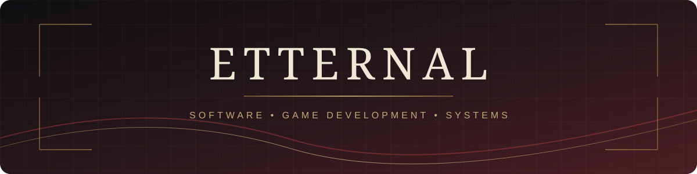

 

## ABOUT

**Independent developer · Software Engineering student**

Building software, gameplay systems, automation and tools through experimentation and continuous learning.

## TECHNOLOGY

### LANGUAGES

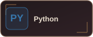
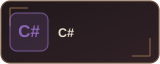
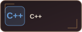
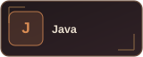
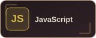
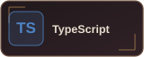

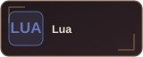

### GAME DEVELOPMENT & MODDING

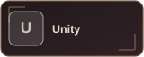
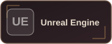
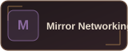
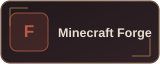
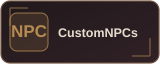
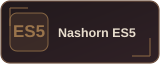

### WEB & BACKEND

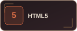
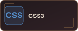
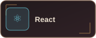
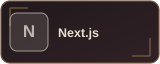
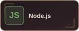
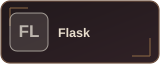
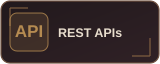
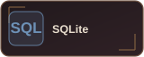
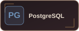

### TOOLS & CREATIVE

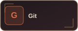
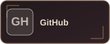
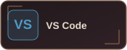
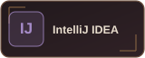
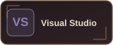
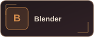
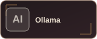
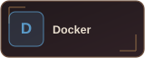
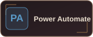

---

Learning through building · Improving through iteration

